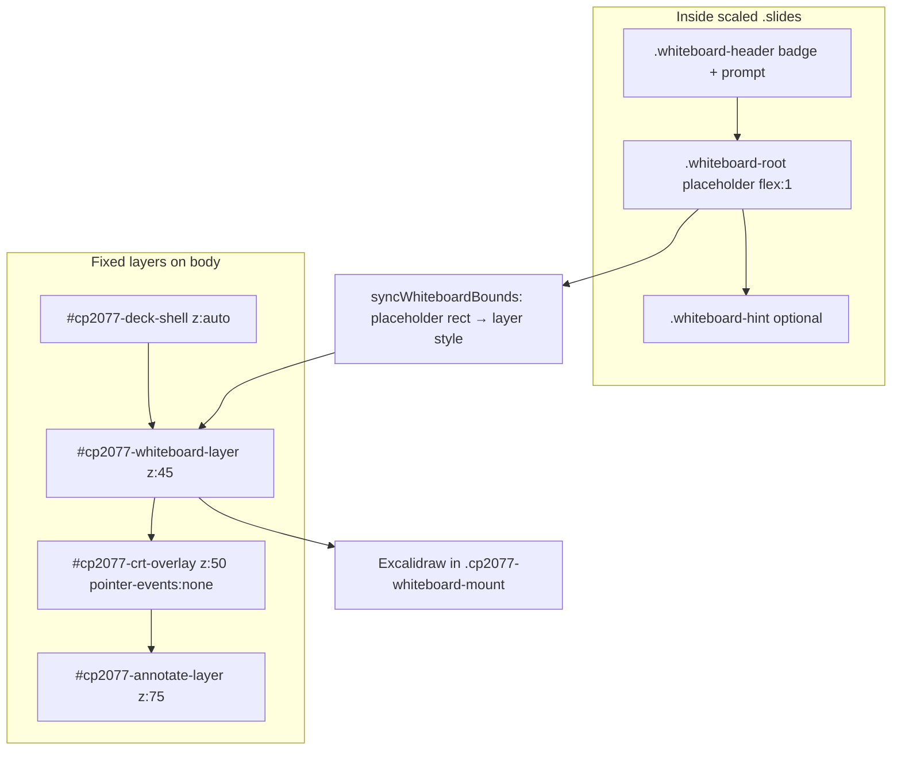

# Whiteboard slides — author and developer guide

Slides live in [content/slides.html](content/slides.html). Component styles: [css/deck.css](css/deck.css).

This guide covers **facilitator board slides** (Excalidraw under the CRT “screen”) and how they differ from **slide annotations** (press **D**, ink above the glass).

---

## Two facilitation modes

| Mode | When to use | Where it draws | Shortcut |
|------|-------------|----------------|----------|
| **Facilitator board slide** | Planned capture: grids, diagrams, category boards | `#cp2077-whiteboard-layer` (fixed overlay, transform-free) | Navigate to the whiteboard slide |
| **Slide annotations** | Quick markup on any slide during Q&A | `#cp2077-annotate-layer` (z-index 75) | **D** (tldreveal) |

Board ink appears under CRT scanlines and vignette. Barrel displacement is **off** on board slides so pointer coordinates stay accurate. Annotation ink stays crisp on top of the glass.

---

## Architecture (overlay mount)

Reveal scales the slide deck (`.slides` with `transform: scale(...)`). Excalidraw cannot be mounted inside that transformed tree without a cursor offset (canvas draws larger than the hit box). The production fix uses a **placeholder + fixed overlay**:



### Z-index stack (viewport)

| z-index | Element | Pointer events |
|--------|---------|----------------|
| (content) | `#cp2077-deck-shell` / `.reveal` | Normal slide navigation |
| **45** | `#cp2077-whiteboard-layer` | Auto when board slide active |
| **50** | `#cp2077-crt-overlay` | None (visual glass only) |
| **75** | `#cp2077-annotate-layer` | Auto when tldreveal active |

### What lives where

| Piece | Role |
|-------|------|
| `.whiteboard-root` | **Layout placeholder only** (flex grow, hidden when overlay active). Defines where the board appears on screen. |
| `#cp2077-whiteboard-layer` | Fixed host; Excalidraw mounts in `.cp2077-whiteboard-mount`. No ancestor `transform` from Reveal. |
| `js/whiteboard-bridge.js` | Mount/unmount, bounds sync, sessionStorage, Ctrl+Shift+S/O |
| `dist/whiteboard/whiteboard.js` | Vite bundle (`npm run build:whiteboard`) |

Default: `whiteboard.mount: 'overlay'` in [js/cp2077-config.js](js/cp2077-config.js). Legacy `mount: 'inSlide'` is unsupported for production (pointer drift returns).

---

## Configuration

In [js/cp2077-config.js](js/cp2077-config.js):

```js
whiteboard: {
  mount: 'overlay',      // 'overlay' | 'inSlide' (do not use inSlide in prod)
  deckId: 'example-deck',  // sessionStorage prefix
  disableBarrel: true,   // fx-whiteboard-active: barrel filter off on deck shell
  debug: false,          // true or ?whiteboardDebug=1 for console diagnostics
},
```

| Key | Default | Meaning |
|-----|---------|---------|
| `mount` | `'overlay'` | Use transform-free overlay host |
| `deckId` | `'example-deck'` | Prefix for `cp2077-whiteboard:{deckId}:{boardId}` |
| `disableBarrel` | `true` | Disables barrel warp on `#cp2077-deck-shell` while board active |
| `debug` | `false` | Enables `cp2077WhiteboardDebug` logging and Ctrl+Shift+D dump |

---

## Build and offline assets

From `presentations/chapter_01`:

```bash
npm install
npm run build:present    # whiteboard.js + Excalidraw fonts/assets + tldreveal vendor
npm run dev              # http://localhost:8000/index.html
```

After editing `js/whiteboard/*.tsx`:

```bash
npm run build:whiteboard
```

[index.html](index.html) loads (in order): `whiteboard-debug.js`, `whiteboard-bridge.js`, and sets:

```js
window.EXCALIDRAW_ASSET_PATH = new URL('dist/whiteboard/assets/', location.href).href;
```

Relative asset paths break offline font loading.

### Source and dist files

| Path | Purpose |
|------|---------|
| `js/whiteboard/whiteboard-app.tsx` | React Excalidraw wrapper |
| `js/whiteboard/entry.tsx` | `CP2077Whiteboard` mount API |
| `js/whiteboard-bridge.js` | Reveal integration + overlay sync |
| `js/whiteboard-debug.js` | Optional diagnostics |
| `css/cp2077-whiteboard-layer.css` | Overlay host styles |
| `css/deck.css` | `.whiteboard-slide` flex layout |
| `dist/whiteboard/whiteboard.js` | Built IIFE bundle |
| `dist/whiteboard/assets/` | Excalidraw fonts (copied on build) |

---

## HTML template

Place a whiteboard slide inside a **vertical stack** (nested `<section>` under a horizontal `<section>`), not as a top-level horizontal slide only.

```html
<section
  class="whiteboard-slide"
  data-whiteboard-id="my-unique-board-id"
>
  <div class="whiteboard-header">
    <span class="activity-badge">Facilitator Board</span>
    <p class="whiteboard-prompt text-sm">
      Short on-slide prompt for participants.
    </p>
  </div>
  <div class="whiteboard-root" aria-label="Facilitator whiteboard layout region"></div>
  <p class="whiteboard-hint text-xs">
    Ctrl+Shift+S export · Ctrl+Shift+O import · Press D to annotate above CRT
  </p>
  <aside class="notes">
    Longer facilitation script for speaker view only.
  </aside>
</section>
```

### Required attributes and classes

| Piece | Purpose |
|-------|---------|
| `class="whiteboard-slide"` | Enables bridge + layout rules |
| `data-whiteboard-id="..."` | Stable id for sessionStorage and export filenames (chapter + topic, not slide index) |
| `.whiteboard-root` | **Empty** placeholder div (Excalidraw renders in overlay, not here) |
| `.whiteboard-header` | Badge + prompt; canvas area is everything below |

### Optional

| Attribute / class | Purpose |
|-------------------|---------|
| `data-whiteboard-src="assets/whiteboards/starter.excalidraw"` | Starter scene when sessionStorage is empty |
| `class="whiteboard-slide--focus"` | Hides on-slide hint; slightly more canvas area |

Example board marker:

```html
<section
  class="whiteboard-slide whiteboard-slide--focus"
  data-whiteboard-id="ex-board-1"
>
  ...
</section>
```

---

## Layout and viewport

Whiteboard slides use flexbox in [css/deck.css](css/deck.css):

- `.whiteboard-slide.present` → `height: 100%` (overrides Reveal `center: true` `min-height: 0` on vertical slides).
- `.whiteboard-header` → shrink-wrap at top.
- `.whiteboard-root` → `flex: 1` for HUD safe area sizing.

When `fx.layers.hud` is on, slide padding uses `--cp-hud-safe` so content stays inside corner brackets.

**Do not** set `position: relative` on `<section>` — Reveal layout breaks on other slides.

---

## Runtime behavior (bridge)

On entering a `.whiteboard-slide`:

1. `html` gets `fx-whiteboard-active` (and `fx-whiteboard-overlay` when `mount: 'overlay'`).
2. `#cp2077-whiteboard-layer` is shown and positioned to match `.whiteboard-root` `getBoundingClientRect()`.
3. Excalidraw mounts in `.cp2077-whiteboard-mount`.
4. `CP2077Whiteboard.refresh()` runs after layout, resize, and slide transition.

On leaving: unmount, hide layer, remove classes.

Bounds sync runs on: `slidetransitionend`, `resize`, `ResizeObserver` on placeholder, window `resize`/`scroll`, and after `Reveal.layout()`.

---

## Slide numbering vs navigation

Reveal uses `slideNumber: 'c/t'`. Counted slides include vertical stacks, so the on-slide counter may not match the horizontal index.

---

## Persistence and files

| Action | Behavior |
|--------|----------|
| Autosave (standalone) | `sessionStorage` key `cp2077-whiteboard:example-deck:{data-whiteboard-id}` (debounced) |
| Autosave (platform live session) | `sessionStorage` key `cp2077-whiteboard:{session_id}:example-deck:{data-whiteboard-id}` — isolated per platform session; cleared when the session ends |
| Export | **Ctrl+Shift+S** on board slide → `{data-whiteboard-id}.excalidraw` |
| Import | **Ctrl+Shift+O** → `.excalidraw` or JSON |
| Next session | Ship `data-whiteboard-src` template or import exported file |

Standalone mode (no `?session=` / `?token=`) keeps the legacy two-segment key so facilitator-only use in one browser tab still autosaves across slide changes. Platform sessions purge legacy keys on connect and clear session-scoped keys on session end — repackaging or uploading the deck does not reset board ink (scene data is not in the zip).

Annotations (tldreveal) use separate per-slide storage; press **D** and use tldreveal’s own export UI.

---

## Starter templates

1. Open board slide in `npm run dev`.
2. Draw layout; **Ctrl+Shift+S** to export.
3. Save under `assets/whiteboards/` (create folder if needed).
4. Set `data-whiteboard-src="assets/whiteboards/your-file.excalidraw"` on the section.

Session data in the same browser wins over the template until cleared.

---

## Pitfalls

| Issue | Fix |
|-------|-----|
| Blank board slide | Run `npm run build:present`; check `dist/whiteboard/whiteboard.js` exists |
| Duplicate `data-whiteboard-id` | Boards overwrite each other in sessionStorage |
| Board only on horizontal slide | Use vertical stack under a parent section for full height |
| Edited TS without rebuild | `npm run build:whiteboard` |
| Confused board vs annotate | Board = under CRT overlay layer; **D** = above CRT |
| Shapes offset from cursor | Confirm `mount: 'overlay'`; never use `inSlide` in production |
| Fonts missing offline | Use `EXCALIDRAW_ASSET_PATH` URL form in `index.html` (already set) |

---

## Troubleshooting pointer offset

1. Confirm [js/cp2077-config.js](js/cp2077-config.js) has `mount: 'overlay'`.
2. Hard refresh after `npm run dev`.
3. Enable debug: `?whiteboardDebug=1` or `whiteboard.debug: true`.
4. On board slide, run `cp2077WhiteboardDebug.dump()` in the console (or **Ctrl+Shift+D**).
5. Expect **`boundsDelta`** (placeholder vs layer) ≈ 0 and **`scaleMismatch.ratio`** ≈ 1.

Paste the JSON between `--- COPY FROM NEXT LINE ---` and `--- END COPY ---` when reporting issues.

---

## Adding a board to another chapter

1. Copy the HTML template into that chapter’s `index.html`.
2. Set `whiteboard.deckId` in that chapter’s `cp2077-config.js`.
3. Use a unique `data-whiteboard-id` (e.g. `ch2-impact-map`).
4. Optional starter in `assets/whiteboards/`.
5. Document navigation in `planning/chapter_XX/chapter_XX_recommendations.md`.
6. Add `[Unreleased]` bullet in that chapter’s `CHANGELOG.md`.

---

## Automated tests

From repo root:

```bash
npx playwright test presentations/chapter_01/tests/e2e/whiteboard.spec.ts
```

Asserts:

- Excalidraw in `#cp2077-whiteboard-layer`, not inside `.slides`
- Overlay bounds within 3px of placeholder
- Canvas width vs host width ratio 0.98–1.02
- Barrel `filter: none` on board slide; restored when leaving
- sessionStorage round-trip

---

## Related docs

- [README.md](README.md) — clone, init, package, upload
- [CHANGELOG.md](CHANGELOG.md) — engine change history
- [COPYRIGHT.md](COPYRIGHT.md) — third-party licenses
